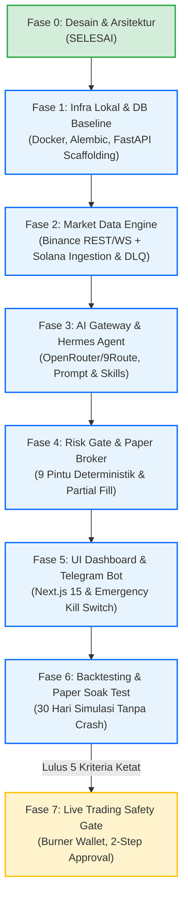

# PANDUAN IMPLEMENTASI & ROADMAP TAHAP 1 s.d. 7 (ROADMAP)
**Dokumen:** `docs/00-overview/ROADMAP.md`  
**Proyek:** AI Crypto Trading & Copy-Trading Platform (AUTO-TRADE-AA)  
**Versi:** 1.0.0 (Tahap 0)  
**Status:** Draf Resmi Roadmap Implementasi  

---

## 1. Ikhtisar Rencana Implementasi

Roadmap ini merinci transisi dari **Tahap 0 (Spesifikasi & Desain Arsitektur)** menuju eksekusi kode terstruktur (Fase 1 hingga Fase 7). Sistem dibangun dengan pendekatan **Modular Monolith First**, **Safety-by-Design**, dan **Paper Trading First**.

---

## 2. Rincian Task Per Fase

### Fase 1 — Infrastruktur Lokal & Database Baseline (Target: 1 Minggu)
**Tujuan:** Membangun runtime lokal kontainer Docker, fondasi database relasional, dan kerangka API backend.

- [ ] **TASK-1.1:** Setup `docker-compose.yml` lokal (`postgres:16-alpine`, persistent volume `.data/postgres_data`, subnet bridge).
- [ ] **TASK-1.2:** Scaffolding direktori backend (`backend/src/`) dengan dependency manager (`pyproject.toml` / `requirements.txt`).
- [ ] **TASK-1.3:** Setup SQLModel / SQLAlchemy base models dan inisialisasi Alembic.
- [ ] **TASK-1.4:** Buat migrasi awal `001_initial_schema_baseline.py` sesuai ERD (10 tabel inti).
- [ ] **TASK-1.5:** Buat endpoint kesehatan `GET /api/v1/health` dengan validasi konektivitas DB dan pooling status.
- [ ] **TASK-1.6:** Validasi resource limit pada host MacBook M1 Pro (RAM $\le$ 2.0 GB untuk DB).

**Kriteria Selesai (Milestone 1):** Database terinisialisasi bersih via migrasi otomatis, API backend berjalan dan merespon `{"status": "ok", "db": "connected"}`.

---

### Fase 2 — Market Data Engine & Ingestion Pipeline (Target: 1-2 Minggu)
**Tujuan:** Mengumpulkan data pasar secara stabil dari Binance Spot dan on-chain Solana dengan penanganan kegagalan eksplisit.

- [ ] **TASK-2.1:** Implementasi Binance Spot Client (REST untuk klines/orderbook + WebSocket untuk ticker & live trades).
- [ ] **TASK-2.2:** Implementasi Solana RPC Ingestion Client (Polling periodik 15s via Helius / Public RPC).
- [ ] **TASK-2.3:** Implementasi normalisasi format transaksi dan deduplikasi signature (`wallet_observations`).
- [ ] **TASK-2.4:** Implementasi penanganan error ingestion: Parser Error Handler, Dead Letter Queue (DLQ), dan Stale Feed Detector.
- [ ] **TASK-2.5:** Implementasi `FRESHNESS_CHECK` gate (data berumur > 30 detik langsung di-drop ke DLQ).
- [ ] **TASK-2.6:** Background worker data aggregation untuk M1, M5, H1 timeframes.

**Kriteria Selesai (Milestone 2):** Data pasar Binance dan on-chain Solana tersimpan di database secara teratur, duplikasi signature ditolak 100%, data stale tidak masuk pipeline agregasi.

**Status:** ✅ **SELESAI** — diverifikasi live (bukan hanya baca kode): Binance REST polling tersimpan ke `market_snapshots` tiap 10 detik, Solana ingestion diuji end-to-end terhadap wallet nyata via Public RPC (fallback Q-04) dan berhasil ter-parse ke `wallet_observations`, duplikasi & data stale masuk `ingestion_errors` (DLQ), serta agregasi M1/M5/H1 ke `market_ohlcv` terbukti jalan.

---

### Fase 3 — AI Model Gateway & Hermes Agent Orchestrator (Target: 1-2 Minggu)
**Tujuan:** Menghubungkan model analitik probabilistik dengan pembatasan hak akses yang terisolasi.

- [ ] **TASK-3.1:** Implementasi AI Gateway Client dengan dual provider: OpenRouter (primer) dan 9Route (fallback otomatis).
- [ ] **TASK-3.2:** Penegakan batas token (`max_tokens: 1000`), timeout 15s, dan parser output JSON terstruktur via Pydantic.
- [ ] **TASK-3.3:** Implementasi Hermes Multi-Agent Orchestrator dengan pemanggilan skill dinamis:
  - `market-regime-detection` (EMA, RSI, MACD, ATR, VWAP)
  - `signal-scoring-hybrid` (Trend Following, Momentum Breakout, Mean Reversion)
  - `token-and-contract-safety` (Audit SPL token mint/freeze authority)
- [ ] **TASK-3.4:** Isolasi hak akses agen: Agen hanya menghasilkan usulan sinyal (`trading_signals`), dilarang memiliki fungsi eksekusi atau modifikasi saldo.

**Kriteria Selesai (Milestone 3):** Prompt evaluasi menghasilkan sinyal terstruktur valid, fallback provider berfungsi saat primer di-mock error HTTP 500, prompt injection tidak mengubah skema output.

**Status:** ✅ **SELESAI** (scaffold + self-check via mock, bukan live call — belum ada API key asli dikonfigurasi). Ketiga kriteria milestone diverifikasi dengan `httpx.MockTransport`: fallback OpenRouter→9Route sukses saat primer di-mock 500, skema Pydantic menolak `action` di luar kontrak, dan key tambahan yang disusupkan ke output LLM otomatis gugur. Hermes loop idle otomatis (bukan crash-loop) selama `OPENROUTER_API_KEY`/`NINEROUTE_API_KEY` masih placeholder.

---

### Fase 4 — Deterministic Risk Gate & Paper Broker Simulator (Target: 1-2 Minggu)
**Tujuan:** Menegakkan keselamatan portofolio mutlak dan simulasi eksekusi tanpa risiko modal.

- [ ] **TASK-4.1:** Implementasi **Deterministic Risk Gate** dengan validasi 9 Pintu secara serial:
  1. Expectancy Positif (setelah fee & slippage)
  2. Risk 0.5% Equity per trade
  3. Daily Loss Limit 2% (cooldown trigger)
  4. Drawdown Limit 8% (freeze trigger)
  5. Spread $\le$ 0.08% & Kedalaman Likuiditas Pool DEX
  6. Stop Loss wajib numerik eksplisit
  7. Lot Size & Saldo Kas mencukupi
  8. Batas Posisi Terbuka Maksimal
  9. Feed Data Segar ($\le$ 30 detik)
- [ ] **TASK-4.2:** Implementasi Paper Broker Matching Engine:
  - Model eksekusi konservatif (harga fill = mid + dynamic slippage, floor 0.05%)
  - Simulasi partial fill proporsional terhadap volume order book
  - Pemotongan taker fee (Binance 0.10%, Solana gas/priority fee)
- [ ] **TASK-4.3:** Portofolio & Compounding Engine (kalkulasi High-Water Mark, penyesuaian lot adaptif).
- [ ] **TASK-4.4:** Feedback Loop: State posisi terbuka dan daily loss ter-update real-time ke Risk Gate.

**Kriteria Selesai (Milestone 4):** 100% sinyal cacat tertolak di pintu risiko; simulasi transaksi mencatat pembukuan presisi tanpa kebocoran deviasi kas vs ekuitas ($= 0.00$).

**Status:** ✅ **SELESAI** — 18 self-check matematis murni (satu per jalur penolakan tiap pintu) lolos semua, dan verifikasi live: sinyal BTCUSDT manual lolos 9 pintu, terisi dengan slippage/fee realistis, posisi terbuka, dan 3 snapshot portofolio berturut-turut menunjukkan `total_equity_usd = cash + positions_value` presisi (deviasi 0.00).

---

### Fase 5 — UI Web Dashboard & Telegram Bot Control (Target: 1 Minggu)
**Tujuan:** Menyediakan antarmuka monitoring human-in-the-loop dan kendali darurat terotentikasi.

- [ ] **TASK-5.1:** Scaffolding Frontend Next.js 15 (TypeScript + Tailwind CSS + Lucide Icons).
- [ ] **TASK-5.2:** Halaman Dashboard: Metrik ekuitas real-time, grafik PnL, status posisi terbuka, log audit sinyal LLM.
- [ ] **TASK-5.3:** Halaman Risk Monitor: Visualisasi 9 pintu risk gate, persentase daily loss saat ini, status drawdown.
- [ ] **TASK-5.4:** Implementasi Bot Telegram:
  - Otentikasi ketat via `TELEGRAM_ALLOWED_USER_ID`
  - Perintah: `/status`, `/pause`, `/resume`
  - Perintah darurat: `/kill` (Emergency Stop)
- [ ] **TASK-5.5:** Pengujian Drill Kill Switch: Pemutusan order baru dalam waktu $\le 2.0$ detik.

**Kriteria Selesai (Milestone 5):** Operator dapat memantau performa via web, menerima alert transaksi, dan memutus sistem via Telegram dalam $\le 2.0$ detik.

**Status:** ✅ **SELESAI** — dashboard (Equity, Risk Monitor 9-pintu, Posisi, Log Sinyal) terhubung live ke API dan diverifikasi dengan screenshot data asli. Emergency Stop diuji end-to-end: `POST /control/kill` membatalkan seluruh sinyal PENDING secara sinkron dalam request itu sendiri (~22ms, jauh di bawah batas 2.0 detik), bukan menunggu siklus loop berikutnya. Bot Telegram (`/status`, `/pause`, `/resume`, `/kill`) memakai jalur kode yang sama dengan REST API, tapi belum diuji live karena belum ada `TELEGRAM_BOT_TOKEN` asli.

---

### Fase 6 — Backtesting Engine & Paper Trading Soak Test (Target: 4 Minggu)
**Tujuan:** Menguji kehandalan strategi secara historis dan menjalankan simulasi tanpa interupsi di lingkungan nyata.

- [ ] **TASK-6.1:** Engine Backtesting historis bebas look-ahead bias dengan data Binance & Solana 60 hari terakhir.
- [ ] **TASK-6.2:** Walk-forward validation (in-sample 70%, out-of-sample 30%).
- [ ] **TASK-6.3:** Pelaksanaan Paper Trading Soak Test selama 30 hari kalender continuous di host MacBook.
- [ ] **TASK-6.4:** Monitoring konsumsi memori dan kestabilan koneksi RPC (target: zero crash).

**Kriteria Selesai (Milestone 6):** Laporan backtest menunjukkan profit factor > 1.25; paper soak test berjalan 30 hari kalender dengan Net PnL positif setelah fee dan zero unhandled crash.

**Status:** 🟡 **SEBAGIAN** — Engine backtesting (TASK-6.1/6.2) selesai & terverifikasi: menarik data Binance historis, walk-forward split 70/30, anti-look-ahead bias terbukti via self-check (AC-SIM-03), dan reuse Risk Gate + Paper Broker asli dari Fase 4 (bukan simulator mainan terpisah). **Run live 60 hari BTCUSDT jujur menunjukkan profit factor 0.41** (di bawah target >1.25) — strategi proxy EMA20/50+RSI yang dipakai untuk backtest adalah pengganti deterministik karena strategi asli memerlukan panggilan LLM per-bar yang tidak feasible/terjangkau untuk ribuan candle historis. Kriteria profit factor Milestone 6 baru bisa dievaluasi jujur setelah Hermes (Fase 3) jalan live dengan API key asli. Soak test 30 hari kalender (TASK-6.3/6.4) belum bisa dimulai — secara fisik butuh 30 hari waktu nyata berjalan, tidak bisa dipercepat.

---

### Fase 7 — Kesiapan Live Trading Safety Gate (Kondisional / Pasca-MVP)
**Tujuan:** Membuka gerbang perdagangan riil hanya jika seluruh 5 kriteria keselamatan terpenuhi.

- [ ] **TASK-7.1:** Audit verifikasi 5 kriteria kesiapan sesuai [LIVE_TRADING_SAFETY_GATE.md](file:///Users/nabilartanabil/SourceCode/AUTO-TRADE-AA/docs/05-security/LIVE_TRADING_SAFETY_GATE.md).
- [ ] **TASK-7.2:** Implementasi Burner Wallet Guard (saldo maksimal 1-2 SOL, pre-order balance check).
- [ ] **TASK-7.3:** Implementasi konfirmasi 2-step approval di dashboard untuk pengaktifan live mode.
- [ ] **TASK-7.4:** Deployment executor terisolasi dengan logging audit kriptografis.

---

## 3. Matriks Ketergantungan Antar-Fase

| Fase | Prasyarat Wajib | Output Kunci | Blokir Jika Gagal |
|---|---|---|---|
| **Fase 1** | Spesifikasi DB ([DATA_MODEL.md](file:///Users/nabilartanabil/SourceCode/AUTO-TRADE-AA/docs/04-data/DATA_MODEL.md)) | DB Schema & API Baseline | Seluruh fase berikutnya |
| **Fase 2** | DB Running (Fase 1) | Pipeline Data Pasar & DLQ | Fase 3, Fase 4 |
| **Fase 3** | Data Tersedia (Fase 2) | Sinyal JSON Terstruktur | Fase 4 |
| **Fase 4** | Sinyal AI (Fase 3) | Risk Engine & Paper Execution | Fase 5, Fase 6 |
| **Fase 5** | API & Risk Engine (Fase 1 & 4) | Dashboard & Kill Switch Bot | Operasi Human-in-the-loop |
| **Fase 6** | Paper Broker Stabil (Fase 4) | Laporan Validasi 30 Hari | Fase 7 |
| **Fase 7** | Soak Test Lulus (Fase 6) | Live Order Executor | Modal riil terlindungi |
