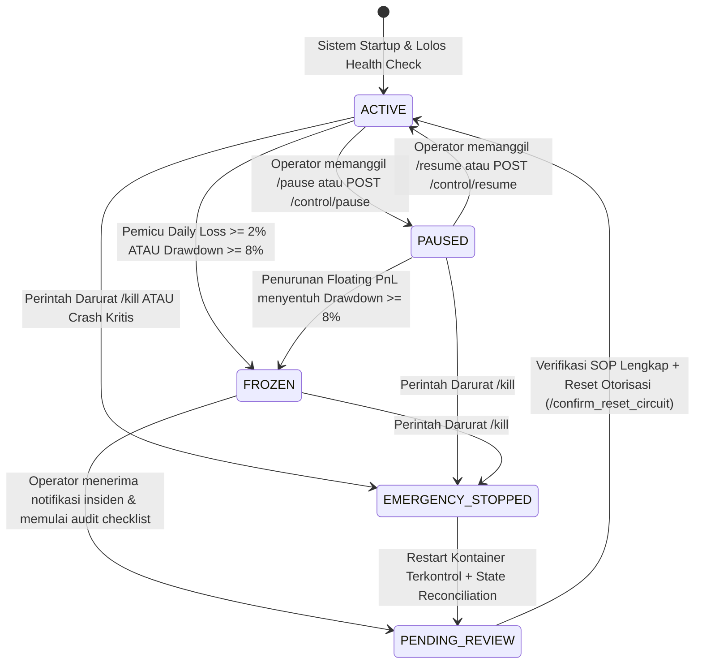

# PROSEDUR OPERASIONAL STANDAR (SOP) CIRCUIT BREAKER & PEMULIHAN SISTEM
**Dokumen:** `docs/05-security/CIRCUIT_BREAKER_OPERATIONAL_SOP.md`  
**Proyek:** AI Crypto Trading & Copy-Trading Platform (AUTO-TRADE-AA)  
**Klasifikasi:** KEAMANAN OPERASIONAL KRITIS (CRITICAL SAFETY SOP)  
**Referensi Terkait:** `BR-RSK-03`, `BR-RSK-04`, `ADR-004`, `ADR-005`, `DOC-TASK-001`  
**Tanggal Berlaku:** 21 Oktober 2026  

---

## 1. Tujuan & Filosofi Keselamatan (Safety Philosophy)

Sistem **AUTO-TRADE-AA** beroperasi dengan mandat keselamatan deterministik mutlak: **Preservasi Modal Lebih Utama Daripada Menangkap Peluang Pasar (Capital Preservation Above All)**.

Mekanisme **Circuit Breaker 4-Layer (Kotak 8 Arsitektur)** dirancang untuk memutus eksekusi secara otomatis saat terdeteksi deviasi abnormal, melindungi akun dari volatilitas ekstrem (*flash crash*), kegagalan feed data, anomali slippage likuiditas, dan kerusakan modal (*risk of ruin*).

Dokumen ini adalah panduan operasional standar bagi operator sistem dalam mengawasi transisi state, melakukan investigasi insiden, menjalankan verifikasi keselamatan portofolio, dan mengeksekusi prosedur pembukaan kembali (*unfreeze/resume*) sistem secara sah dan terkontrol.

---

## 2. Rincian 4-Layer Circuit Breaker & Kondisi Pemicu Numerik

Sistem mengawasi 4 layer pemicu keselamatan secara kontinu pada setiap siklus evaluasi Risk Engine (interval default: 5 detik):

```
┌───────────────────────────────────────────────────────────────────────────────────┐
│                      4-LAYER CIRCUIT BREAKER ARCHITECTURE                         │
└───────────────────────────────────────────────────────────────────────────────────┘
   Layer 1: Daily Loss Limit        │ Kerugian 24 Jam >= 2.0% dari Ekuitas
   Layer 2: Max Drawdown Limit      │ Penurunan >= 8.0% dari High-Water Mark (HWM)
   Layer 3: Market Data Stale       │ Usia Data Harga > 30 Detik / Koneksi Putus
   Layer 4: Execution / Slippage    │ Slippage Eksekusi > 0.50% / Spread > 0.08%
─────────────────────────────────────────────────────────────────────────────────────
   Tindakan Otomatis (Fail-Closed)  │ Kunci UserSetting 'CIRCUIT_BREAKER_ACTIVE' = true
                                    │ Blokir Pintu 8 Risk Gate (Semua Order Baru Ditolak)
                                    │ Batalkan Sinyal 'PENDING' Secara Sinkron
                                    │ Kirim Peringatan Kritis ke Telegram Operator
```

### 2.1 Layer 1: Daily Loss Limit ($\ge 2.0\%$ Ekuitas)
- **Kondisi Pemicu Numerik:**  
  $$\text{Daily Loss Pct} = \frac{|\text{Daily Realized PnL}|}{\text{Total Equity Snapshot Pukul 00:00 UTC}} \times 100\% \ge 2.00\%$$
- **Deteksi:** Dievaluasi setiap kali ada posisi yang ditutup atau diperbarui pada `_write_snapshot()` di `backend/src/risk/engine.py`.
- **Dampak Otomatis:**
  - Status `CIRCUIT_BREAKER_ACTIVE` diset ke `true` di tabel `user_settings`.
  - Entri baru dihentikan seketika. Seluruh order aktif/sinyal yang berstatus `PENDING` dibatalkan (`REJECTED`).
  - Posisi terbuka yang sudah ada **TIDAK DITUTUP PAKSA SECARA MEMBABI-BUTA**, melainkan tetap dikelola oleh trailing stop dan stop loss aktif untuk menghindari *market impact* saat likuiditas tipis.
- **Tingkat Keparahan Notifikasi:** `CRITICAL` via Telegram & Alert Dispatcher.

### 2.2 Layer 2: Maximum Drawdown Limit ($\ge 8.0\%$ dari High-Water Mark)
- **Kondisi Pemicu Numerik:**  
  $$\text{Current Drawdown Pct} = \frac{\text{High-Water Mark (HWM)} - \text{Total Equity}}{\text{High-Water Mark (HWM)}} \times 100\% \ge 8.00\%$$
- **Deteksi:** Dihitung mark-to-market secara real-time pada tabel `portfolio_snapshots`.
- **Dampak Otomatis:**
  - Pembekuan total strategi trading (*System Freeze*).
  - Status `CIRCUIT_BREAKER_ACTIVE` dan `TRADING_PAUSED` diset ke `true`.
  - Sistem terkunci hingga operator melakukan peninjauan performa manual dan memberikan otorisasi khusus bertingkat dua (*2-Step Confirmation*).
- **Tingkat Keparahan Notifikasi:** `CRITICAL` via Telegram dengan tagar `#DRAWDOWNSAFETY`.

### 2.3 Layer 3: Market Data Stale & Feed Disconnect ($> 30$ Detik)
- **Kondisi Pemicu Numerik:**  
  $$\Delta t_{\text{data}} = t_{\text{sistem}} - t_{\text{snapshot\_time}} > 30.0 \text{ detik} \quad \text{ATAU} \quad \text{is\_stale} == \text{true}$$
- **Deteksi:** Pintu 9 pada `evaluate_risk()` di `backend/src/risk/gate.py`.
- **Dampak Otomatis:**
  - Sistem menolak seluruh pembuatan order baru (`REJECTION_REASONS: ["STALE_MARKET_DATA"]`).
  - Mengisolasi strategi dari harga halusinasi (*phantom pricing*) akibat putusnya WebSocket Binance Spot atau keterlambatan polling Solana RPC.
  - Sinyal yang terbit selama masa *stale* akan kedaluwarsa otomatis dalam 5 menit.
- **Tingkat Keparahan Notifikasi:** `WARNING` jika berlangsung 30–60 detik; `CRITICAL` jika putus $> 120$ detik.

### 2.4 Layer 4: Anomali Slippage Eksekusi & Likuiditas Pool ($> 0.50\%$)
- **Kondisi Pemicu Numerik:**  
  $$\text{Spread Pct} > 0.0800\% \quad \text{ATAU} \quad \text{Executed Slippage} > 0.5000\% \quad \text{ATAU} \quad \text{Volume 24h} < \$1.000.000 \text{ USD}$$
- **Deteksi:** Pintu 5 Risk Gate dan audit perbandingan antara `paper_orders.requested_price` vs `paper_trades.executed_price`.
- **Dampak Otomatis:**
  - Penolakan transaksi pada instrumen terkait (`SPREAD_OR_LIQUIDITY_INADEQUATE`).
  - Jika terjadi anomali slippage eksekusi berturut-turut pada 3 order simulasi, strategi yang merekomendasikan token tersebut otomatis di-pause.
- **Tingkat Keparahan Notifikasi:** `WARNING` ke Telegram.

---

### 2.5 Pemicu Tambahan: Rust Risk Gate Engine Tak Terjangkau (hanya bila `ENGINE_URL` diisi)
- **Kondisi Pemicu:** `call_risk_engine()` mendapat koneksi ditolak (`ENGINE_UNAVAILABLE`).
- **Deteksi:** `backend/src/risk/engine_client.py`, dipanggil dari `_process_signal` di `backend/src/risk/engine.py`.
- **Dampak Otomatis:** sinyal ditolak, `CIRCUIT_BREAKER_ACTIVE = true`, `SystemEvent` `CIRCUIT_BREAKER_TRIGGERED` severity `CRITICAL`. Timeout / HTTP error / balasan invalid juga menolak sinyal, tapi **tidak** memicu freeze.
- **Pemulihan:** hidupkan engine atau kosongkan `ENGINE_URL`, verifikasi, lalu `/resume`.
- **Catatan:** notifikasi Telegram otomatis untuk `SystemEvent` belum tersambung (gap FR-TG-01) — pantau dashboard/log.

---

## 3. Diagram State Machine & Transisi Siklus Hidup Sistem

Siklus hidup operasional platform diatur melalui *Finite State Machine (FSM)* deterministik yang tercermin pada flag `user_settings` dan audit log `system_events`:



### Tabel Matriks Definisi State Sistem

| State Sistem | `TRADING_PAUSED` | `CIRCUIT_BREAKER_ACTIVE` | Perilaku Modul Ingestion | Perilaku Hermes Agent | Perilaku Risk Gate | Perilaku Paper Broker |
|---|---|---|---|---|---|---|
| **`ACTIVE`** | `false` | `false` | Normal (WS & RPC aktif) | Menghasilkan sinyal | Mengevaluasi 9 pintu | Mengeksekusi & memantau posisi |
| **`PAUSED`** | `true` | `false` | Normal (Memperbarui data) | Menghasilkan sinyal | Menolak order baru | Memantau & mengawal posisi SL/TP |
| **`FROZEN`** | `true` | `true` | Normal (Memantau harga) | Dihentikan sementara | Menolak keras seluruh order | Memantau & mengawal posisi SL/TP |
| **`EMERGENCY_STOPPED`** | `true` | `true` | Terputus / dihentikan | Dihentikan seketika | Fail-Closed permanen | Membatalkan semua order PENDING |
| **`PENDING_REVIEW`** | `true` | `true` | Read-only Diagnostic | Siaga (Standby) | Menolak order baru | Menghitung valuasi portofolio bersih |

---

## 4. Checklist Keselamatan Pra-Resume (Mandatory Pre-Flight Checklist)

Sebelum operator mengeksekusi perintah reset `/resume` atau memanggil endpoint API, **seluruh 10 butir checklist di bawah ini wajib diverifikasi dan dipenuhi**:

> [!CAUTION]
> Membuka kembali (*resuming*) sistem tanpa melengkapi checklist keselamatan dapat mengakibatkan akumulasi kerugian beruntun (*compounding losses*) atau kerusakan permanen portofolio.

- [ ] **1. Identifikasi Akar Masalah (Root Cause Analysis):**  
  Penyebab pemicu telah diidentifikasi secara jelas (misal: fluktuasi tajam BTC, anomali pool token SPL, atau terputusnya koneksi internet host).
- [ ] **2. Audit Posisi Terbuka Aktif:**  
  Kueri `SELECT symbol, current_quantity, unrealized_pnl_usd, current_stop_loss FROM positions WHERE status IN ('OPEN', 'PARTIALLY_CLOSED');` memastikan tidak ada posisi tak terkendali tanpa stop loss.
- [ ] **3. Rekonsiliasi Saldo Kas & Ekuitas:**  
  Verifikasi matematis terpenuhi: $\text{Total Ekuitas} = \text{Saldo Kas} + \text{Nilai Posisi Terbuka}$. Selisih pembukuan wajib $0.00$.
- [ ] **4. Evaluasi Tingkat Drawdown Terkini:**  
  Jika Drawdown $\ge 8\%$, operator wajib menilai apakah parameter sizing portofolio perlu diturunkan sementara (misal: risk per trade diturunkan ke 0.25%).
- [ ] **5. Verifikasi Kesegaran Data Pasar (Market Data Freshness):**  
  WebSocket Binance Spot (`@trade`) dan Solana RPC menerima update dengan selisih waktu $\le 5$ detik dari jam sistem host.
- [ ] **6. Status Kesehatan Node Solana & API Binance:**  
  Tidak ada indikasi *rate-limiting* (HTTP 429), pemeliharaan bursa terpusat (*scheduled maintenance*), atau kemacetan jaringan (*network congestion*).
- [ ] **7. Verifikasi Kuota & Ketersediaan Model AI:**  
  Penyedia LLM (OpenRouter / 9Route) memiliki saldo/kuota aktif dan merespons uji ping dalam $\le 3$ detik.
- [ ] **8. Audit Ketersediaan Memori & Sumber Daya Host:**  
  Penggunaan RAM kontainer backend dan PostgreSQL berada di bawah 80% dari batas Docker (MacBook M1 Pro).
- [ ] **9. Verifikasi Tidak Ada Error Berulang di Log:**  
  Output `docker compose logs --tail=100 backend` bebas dari *unhandled exceptions* atau perulangan koneksi database putus.
- [ ] **10. Otorisasi Formal Operator (2-Step Authorization):**  
  Operator mengonfirmasi kesiapan reset melalui token rahasia atau perintah konfirmasi Telegram `/confirm_reset_circuit`.

---

## 5. Prosedur Pemulihan Langkah Demi Langkah (Step-by-Step Recovery SOP)

### 5.1 Prosedur A: Rilis / Unfreeze Melalui Bot Telegram (Remote Mobile Recovery)

Prosedur ini digunakan saat operator berada jauh dari workstation:

1. **Periksa Status Sistem:**  
   Kirim perintah `/status` ke Bot Telegram.  
   *Respons yang diharapkan:* Ringkasan ekuitas, status drawdown, `paused: true`, `circuit_breaker_active: true`.
2. **Kirim Perintah Permohonan Resume:**  
   Kirim perintah `/resume`.
3. **Penanganan Kasus Drawdown $\ge 8.0\%$ (Konfirmasi Dua Langkah):**  
   - Jika Circuit Breaker terpicu oleh Drawdown $\ge 8.0\%$, bot akan membalas:  
     `⚠️ PERINGATAN KRITIS: Drawdown sistem saat ini 8.12% (>= 8.00%). Pembukaan kembali memerlukan konfirmasi sadar. Ketik '/confirm_reset_circuit' dalam 60 detik untuk melanjutkan.`
   - Operator mengirimkan: `/confirm_reset_circuit`.
   - Bot mereset flag di database dan membalas: `✅ CIRCUIT BREAKER DIBUKA KEMBALI. Trading aktif kembali pada pengawasan operator.`
4. **Penanganan Kasus Daily Loss $\ge 2.0\%$ / Stale Data:**  
   - Perintah `/resume` langsung memulihkan status ke normal dan mengaktifkan kembali evaluasi sinyal.

### 5.2 Prosedur B: Rilis Melalui Web Dashboard / REST API (Workstation Recovery)

Prosedur ini dilakukan dari terminal lokal workstation atau antarmuka web:

1. **Investigasi Log Sistem:**
   ```bash
   docker compose logs backend --tail=50 --timestamps
   ```
2. **Eksekusi Endpoint Status Terotentikasi:**
   ```bash
   curl -s -X GET http://localhost:8000/control/status \
     -H "X-API-Key: $(grep BACKEND_API_SECRET .env | cut -d '=' -f2)" | jq .
   ```
3. **Eksekusi Pemulihan Sistem:**
   ```bash
   curl -s -X POST http://localhost:8000/control/resume \
     -H "X-API-Key: $(grep BACKEND_API_SECRET .env | cut -d '=' -f2)" \
     -H "Content-Type: application/json" \
     -d '{"reason": "Audit SOP completed, market stable, manual reset authorized"}' | jq .
   ```
   *Respons yang diharapkan:*
   ```json
   {
     "paused": false,
     "circuit_breaker_active": false,
     "message": "Operator resumed trading."
   }
   ```
4. **Verifikasi Pencatatan Audit Trail:**
   Periksa entri terbaru di database:
   ```bash
   docker compose exec postgres psql -U autotrade_app -d autotrade_db -c \
     "SELECT event_type, severity, message, created_at FROM system_events ORDER BY created_at DESC LIMIT 3;"
   ```

### 5.3 Prosedur C: Penanganan Darurat Ekstrem (Emergency Stop / Kill Switch Recovery)

Jika terjadi anomali ekstrem (misal: bug perulangan order, kegagalan database, atau anomali harga):

1. **Pemicu Darurat Instan ($\le 2.0$ detik):**  
   Kirim perintah Telegram `/kill` ATAU panggil `POST /control/kill`.  
   Sistem secara sinkron membatalkan seluruh sinyal `PENDING`, mengaktifkan `CIRCUIT_BREAKER_ACTIVE`, dan memutus loop Risk Engine.
2. **Matikan Layanan Jika Diperlukan:**
   ```bash
   docker compose stop backend
   ```
3. **Lakukan Rekonsiliasi Database:**  
   Pastikan tidak ada data korup atau transaksi menggantung.
4. **Nyalakan Kembali Secara Bertahap:**
   ```bash
   docker compose up -d backend
   ```
   Saat startup, sistem otomatis memverifikasi konsistensi saldo dan berada dalam mode aman hingga operator memanggil `/resume`.

---

## 6. Template Laporan Pasca-Insiden (Post-Mortem Template)

Setiap kali Circuit Breaker Layer 1 atau Layer 2 terpicu, operator wajib mengisi catatan insiden ringkas untuk keperluan audit:

```markdown
# INCIDENT POST-MORTEM REPORT
- Tanggal & Waktu Kejadian: [YYYY-MM-DD HH:MM:SS UTC]
- Pemicu Circuit Breaker: [Daily Loss >= 2% / Drawdown >= 8% / Stale Data / Slippage Anomaly / Rust Engine Unavailable]
- Nilai Metrik Saat Kejadian: 
  * Total Equity: $... USD
  * Drawdown Pct: ...%
  * Daily Loss Pct: ...%
- Simbol / Aset Terkait: [BTCUSDT / SOLUSDT / SPL Token Address]
- Ringkasan Kejadian: 
  [Jelaskan kondisi pasar atau anomali sistem yang memicu pembekuan]
- Tindakan yang Diambil:
  [Checklist audit yang dilakukan dan keputusan penyesuaian parameter]
- Waktu Pemulihan (Downtime Duration): [... Menit]
- Otorisasi Pemulihan: [Disetujui oleh Operator Solo via Telegram / REST API]
```
