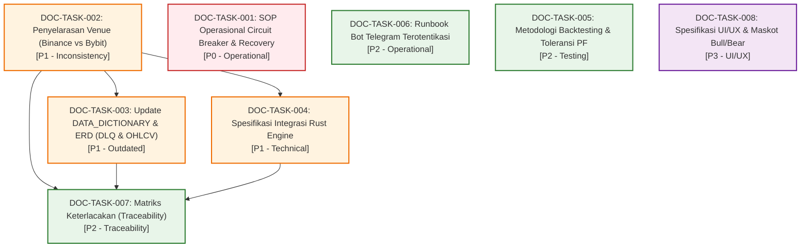

# MATRIKS KETERGANTUNGAN TUGAS DOKUMENTASI (DOCUMENTATION DEPENDENCIES)
**Proyek:** AI Crypto Trading & Copy-Trading Platform (AUTO-TRADE-AA)  
**Dokumen:** `docs/audit/DOCUMENTATION_DEPENDENCIES.md`  
**Tanggal Audit:** 21 Oktober 2026  

---

## 1. Analisis Ketergantungan Logis Antar-Tugas Dokumentasi

Pengerjaan tugas dokumentasi harus mengikuti urutan dependensi logis agar tidak terjadi kerja ulang (*rework*) dan informasi yang dicatat pada dokumen hilir (*downstream*) selalu berlandaskan kebenaran yang telah disahkan pada dokumen hulu (*upstream*).

---

## 2. Tabel Matriks Ketergantungan Tugas

| Task ID | Judul Tugas Dokumentasi | Prasyarat Wajib (Prerequisites) | Menjadi Prasyarat Untuk (Blocks) | Alasan Ketergantungan Logis |
|---|---|---|---|---|
| **`DOC-TASK-001`** | SOP Operasional Circuit Breaker | *Tidak ada (Independen)* | — | Penulisan SOP pemulihan status freeze dapat langsung disusun berlandaskan kode `backend/src/risk/gate.py` dan `control.py`. |
| **`DOC-TASK-002`** | Penyelarasan Venue (Binance vs Bybit) | *Tidak ada (Fondasi Hulu)* | `DOC-TASK-003`, `DOC-TASK-004`, `DOC-TASK-007` | Nama bursa CEX resmi (Binance Spot) wajib seragam sebelum memperbarui kamus data token, format fee transaksi, dan kontrak API Rust. |
| **`DOC-TASK-003`** | Update Kamus Data & ERD (DLQ & OHLCV) | `DOC-TASK-002` | `DOC-TASK-007` | Entitas bursa pada skema tabel data harus selaras sebelum mendokumentasikan tabel relasional baru `market_ohlcv` dan `ingestion_errors`. |
| **`DOC-TASK-004`** | Spesifikasi Integrasi Rust Engine | `DOC-TASK-002` | `DOC-TASK-007` | Skema kontrak data `SignalCandidate` dan `PaperOrderRequest` di Rust membutuhkan kepastian simbol aset bursa yang seragam. |
| **`DOC-TASK-005`** | Metodologi Backtesting & Toleransi PF | *Tidak ada (Independen)* | `DOC-TASK-007` | Dokumentasi klarifikasi strategi proxy backtesting dapat langsung dikerjakan berdasarkan evaluasi kode `backend/src/backtest/engine.py`. |
| **`DOC-TASK-006`** | Runbook Bot Telegram Terotentikasi | *Tidak ada (Independen)* | — | Petunjuk konfigurasi bot dan uji silent-drop dapat disusun langsung merujuk pada `backend/src/control/telegram_bot.py`. |
| **`DOC-TASK-007`** | Matriks Keterlacakan Kebutuhan ke Kode | `DOC-TASK-002`, `DOC-TASK-003`, `DOC-TASK-004` | — | Matriks penelusuran menyeluruh hanya valid jika dokumen spesifikasi hulu (venue bursa, kamus data skema, dan batas modul Rust) sudah tersinkronisasi. |
| **`DOC-TASK-008`** | Spesifikasi UI/UX & Maskot Bull/Bear | *Tidak ada (Independen)* | — | Dokumentasi komponen visual maskot dan styling frontend bersifat mandiri dan tidak memblokir domain backend. |

---

## 3. Urutan Eksekusi yang Direkomendasikan (Recommended Execution Order)

Berdasarkan matriks prioritas dan grafik ketergantungan di atas, urutan eksekusi tugas dokumentasi yang paling optimal adalah:

1. **Langkah 1 (Fondasi Penyelarasan Arsitektur):**
   - Kerjakan **`DOC-TASK-002`** (Penyelarasan Nomenklatur Venue Binance vs Bybit) untuk menghilangkan inkonsistensi paling fundamental.
2. **Langkah 2 (Prosedur Keselamatan Kritis):**
   - Kerjakan **`DOC-TASK-001`** (SOP Operasional Circuit Breaker & Recovery) untuk memastikan kontrol keselamatan modal terdokumentasi jelas.
3. **Langkah 3 (Sinkronisasi Model Data & Engine):**
   - Kerjakan **`DOC-TASK-003`** (Pembaruan Kamus Data & ERD untuk tabel `ingestion_errors` dan `market_ohlcv`).
   - Kerjakan **`DOC-TASK-004`** (Spesifikasi Integrasi Core Engine Rust).
4. **Langkah 4 (Pengujian & Operasional):**
   - Kerjakan **`DOC-TASK-005`** (Metodologi Backtesting & Toleransi Profit Factor Fase 6).
   - Kerjakan **`DOC-TASK-006`** (Runbook Operasional Bot Telegram).
5. **Langkah 5 (Keterlacakan & Visual UI/UX):**
   - Kerjakan **`DOC-TASK-007`** (Matriks Keterlacakan Kebutuhan ke Kode Sumber).
   - Kerjakan **`DOC-TASK-008`** (Spesifikasi UI/UX Komponen Visual Maskot Bull/Bear).
